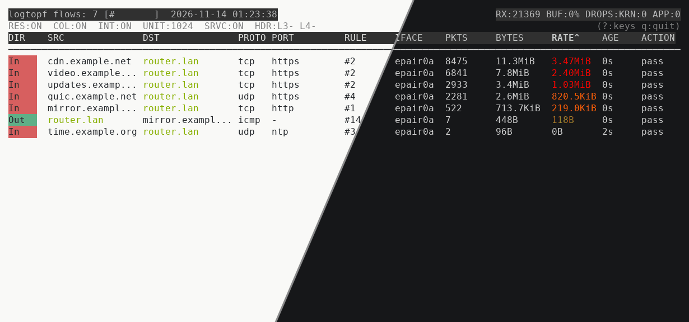
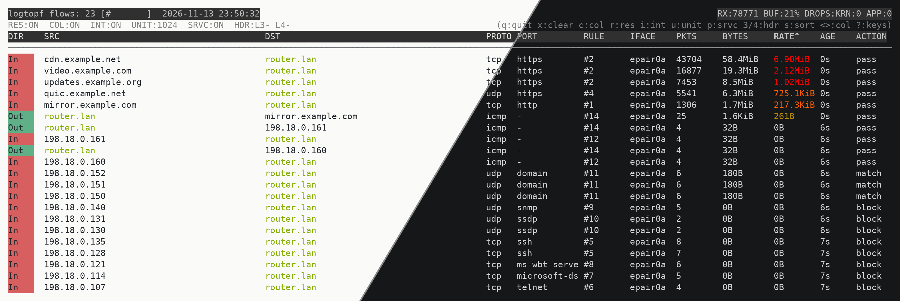

<h1 align="center">logtopf 🍲</h1>

<p align="center">
  <b>A live terminal view of the packets <code>pf</code> logs on FreeBSD.</b><br>
  <sub>German for "log pot". Light enough for the smallest firewall, at home over SSH, tmux or a serial console.</sub>
</p>

<p align="center">
  
  
  
</p>



<sub>Demo traffic from the test VM; hostnames are made up.</sub>

## Why

`pftop` shows every state `pf` is tracking, which on a busy firewall is mostly noise. logtopf only shows the traffic you tagged with `log` in your rules, grouped into flows with packet, byte and rate counters, so you see exactly what you asked to watch:

- **What's being blocked**, by which rule, and from where
- **Who's using the bandwidth**, live, sorted by rate
- **What your `match` and `nat` rules actually catch**

`pf` sends logged packets to the `pflog0` interface, each wrapped in a header with the rule number, action, interface and direction. logtopf reads that interface directly with libpcap.

## Light on the box

logtopf is made to run on the firewall itself, even a small appliance or a VM with little CPU and memory to spare. It reads only the start of each packet, keeps at most 2048 flows, and redraws once a second, so it stays cheap even when traffic is heavy.

| Logged packets per second | logtopf CPU | logtopf memory | pflogd CPU, for comparison |
|---|---|---|---|
| none | 0.1% | 6 MiB | 0% |
| none, with 2048 flows on screen | 1.0% | 13 MiB | 0% |
| 1,000 | 0.7% | 16 MiB | 0.03% |
| 10,000 | 0.5% | 16 MiB | 0.2% |
| 100,000 | 1.1% | 17 MiB | 1.5% |
| 100,000 from a scan or flood ¹ | 2.8% | 17 MiB | 1.4% |
| 1,100,000 | 7.8% | 17 MiB | 18% |
| 1,000,000 from a scan or flood ¹ | 19% | 17 MiB | 16% |

- **CPU** is a share of one core: 100% would be one core fully busy.
- **pflogd** is the logger FreeBSD already runs. It read the same packets at the same time. `tcpdump -n`, for contrast, needed a quarter of a core at 100,000 packets a second and a whole core above that.
- ¹ Every packet is from a new address, so logtopf has to drop an old flow to make room for each one. This is the worst case.
- No packets were lost, apart from 0.05% at a million a second with FreeBSD's default capture buffer.

**On a minimal VM** with 1 vCPU and 512 MB, at 330,000 packets a second (the most that VM could generate), logtopf used 1.9% of the CPU (5.1% for a scan or flood) and 17 MiB, and lost nothing.

<sub>Measured in KVM guests running FreeBSD 14.5 on a Ryzen 7 7735HS; the table is from a 4 vCPU guest. CPU counts logtopf's own work, not pf's. `test/cpu_bench.py` reproduces it.</sub>

## Quick start

You need FreeBSD 14 or newer (tested on 14.5 and 15.1; pfSense and OPNsense are built on it), root or read access to `/dev/bpf`, and the libpcap and ncurses that come with the base system.

```sh
./build.sh
man ./logtopf.1
```

Add `log` to the rules you want to watch in `/etc/pf.conf`, and reload:

```pf
pass in log (all) on $lan proto tcp to port { 80 443 }
block in log on $wan
```

```sh
pfctl -f /etc/pf.conf
./logtopf            # reads pflog0; or ./logtopf pflog1
```

Plain `log` only records the packet that creates a state, so you'd see one packet per connection. Use `log (all)` where you want byte counts and rates for whole connections.

## Using it

Each row is a flow: direction, source, destination, protocol, port, rule, interface and action, with packets, bytes, rate and time since the last packet. The port shown is the lower of the two, which is the service port for nearly all traffic, so a client opening many connections to one server is a single row. Addresses on the machine's own subnets are highlighted.



| Key | |
|---|---|
| `↑` `↓` | Scroll |
| `←` `→` | Change the sort column |
| `s` | Reverse the sort order |
| `x` | Clear the flow table |
| `r` | Hostname resolution on/off |
| `p` | Port names on/off (`443` or `https`) |
| `c` | Colour on/off (direction fill and rate gradient) |
| `i` | Highlighting of local addresses on/off |
| `u` | Units: 1024-based (KiB) or 1000-based (KB) |
| `3` `4` | Count IP / TCP and UDP header bytes in BYTES and RATE |
| `Ctrl-L` | Repaint the whole screen, e.g. after line noise |
| `?` | Show the keys |
| `q` | Quit |

## How it works

```
pflog0 ─▶ capture thread ─▶ ring buffer ─▶ worker thread ─▶ flow table ─▶ UI thread ─▶ terminal
          parse headers     lock-free      aggregate        2048 flows
                                                                          ▲
                                                                          └── resolver thread (hostnames)
```

- **Capture.** Reads `pflog0` with libpcap, parses the pflog, IPv4/IPv6 (fragments and extension headers included) and TCP/UDP headers, and pushes small fixed-size entries into a lock-free ring buffer. It keeps only the first 192 bytes of each packet and, when allowed, runs at real-time priority. If the worker falls behind it waits for it, and the kernel keeps buffering meanwhile.
- **Flows.** A worker thread drains the ring into a 2048-flow hash table. Counters are atomics; only creating or evicting a flow takes a lock. When the table is full, the flows seen least recently make room.
- **Rates.** Bytes per second over a 2-second window, timed by when packets arrived rather than when the screen redraws, so the number doesn't jump when the kernel hands packets over in bursts. Toggling header counting with `3` and `4` doesn't disturb it.
- **Names.** Hostnames are resolved on their own thread and never hold up drawing.

## Drops

The status line has two drop counters:

- **KRN**: packets the kernel dropped because its capture buffer filled before logtopf read it. logtopf asks for 4 MiB, and the kernel grants at most `net.bpf.maxbufsize`, 512 KiB on a stock system. That kept up with over a million logged packets a second in testing, but if KRN climbs on your box, raise both:

  ```sh
  sysctl net.bpf.maxbufsize=16777216   # add to /etc/sysctl.conf to keep it
  ./logtopf -B 16384                   # KiB
  ```

  The kernel double-buffers captures, so this costs up to three times the size in memory: two buffers in the kernel, one copy in logtopf.

- **APP**: packets dropped between logtopf's own threads. The capture thread waits for the worker rather than drop, so this only counts if the worker stalls for two seconds. It should stay at 0.

## Over a serial console

The once-a-second refresh only sends what changed, so it uses about 9% of a 9600 baud line with a busy table. Scrolling never queues frames: hold an arrow key and it skips ahead as fast as the line allows, then stops when you let go. If line noise garbles the screen, `Ctrl-L` repaints it. `test/serial_bench.py` measures this.

## Testing

`test/` boots a FreeBSD VM (14.5, or 15.1 with `LOGTOPF_REL=15.1`) with QEMU/KVM and runs logtopf against real `pf` rules. A small packet generator writes crafted frames into an `epair` interface through BPF, so they go through `pf` and `pflog0` like real traffic, and each scenario checks the rendered screen through tmux.

```sh
test/vm.sh up        # first run downloads the image (~650 MB) and provisions it
test/vm.sh sync      # copy the sources in and build
test/run.py          # all scenarios, or some of: basic actions stress clear rate resolve render
test/vm.sh down
```

Inside the VM, `test/cpu_bench.py` produces the CPU and memory numbers above and `test/serial_bench.py` the serial ones; `test/screenshot.py` and `test/demo_gif.py` stage the demo traffic and render the screenshot and the GIF, light and dark.

## License

BSD 2-Clause. See [LICENSE](LICENSE).
